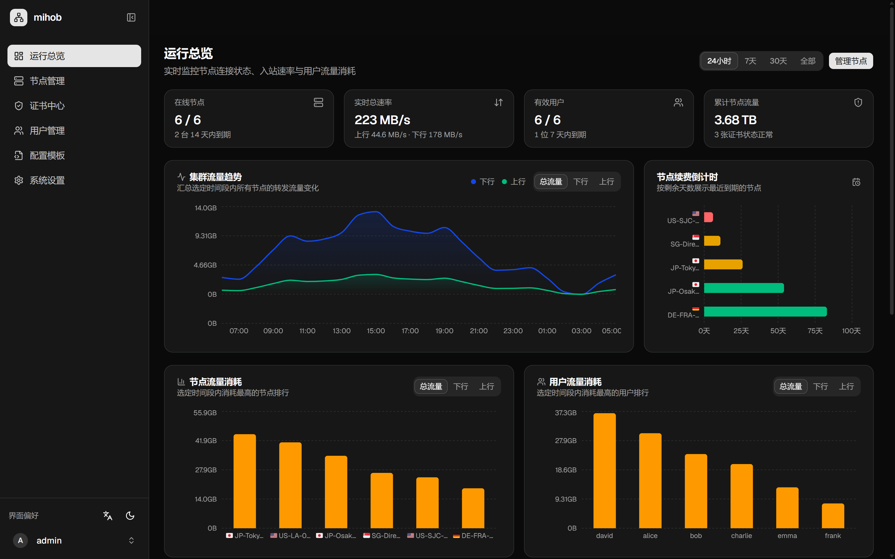
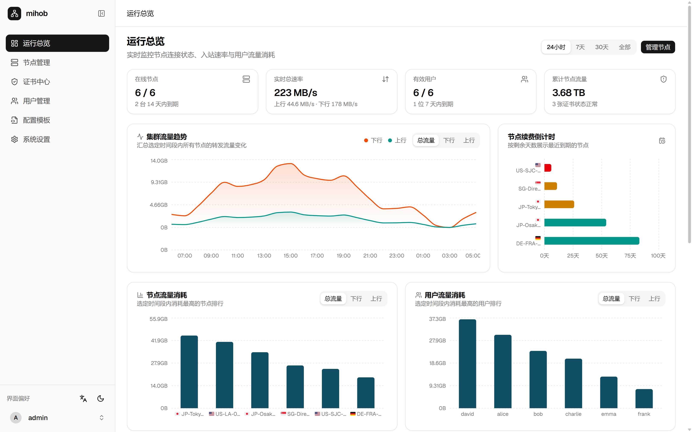
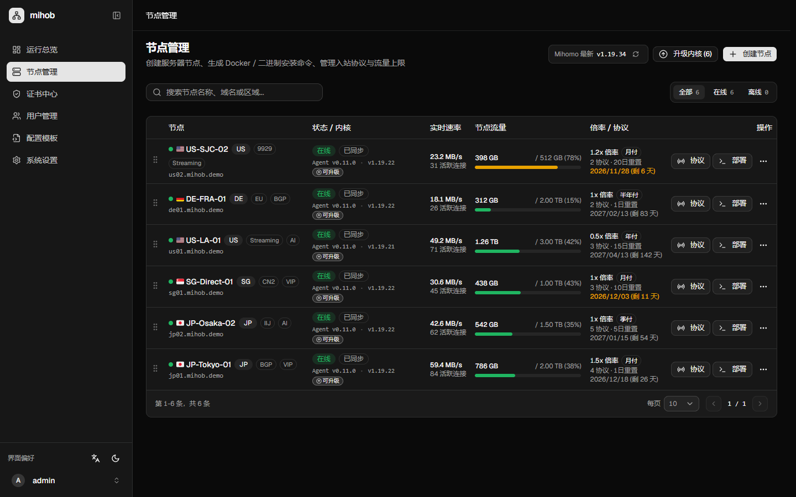
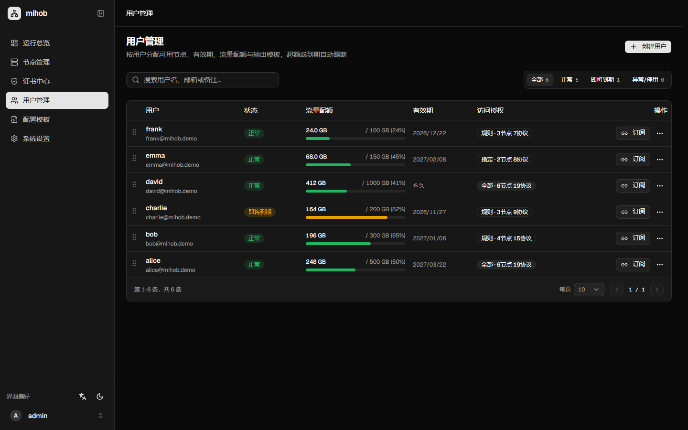
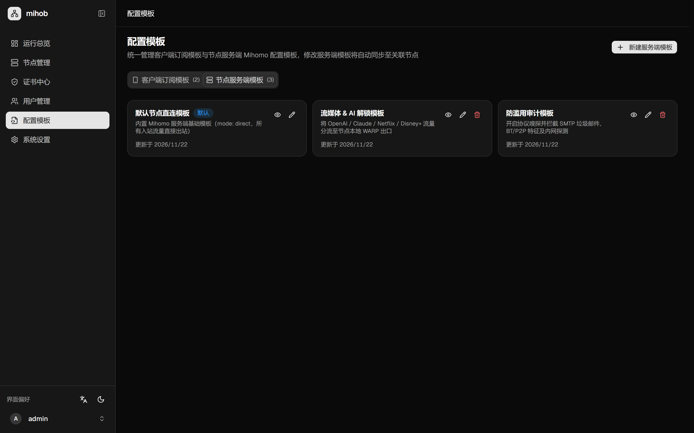
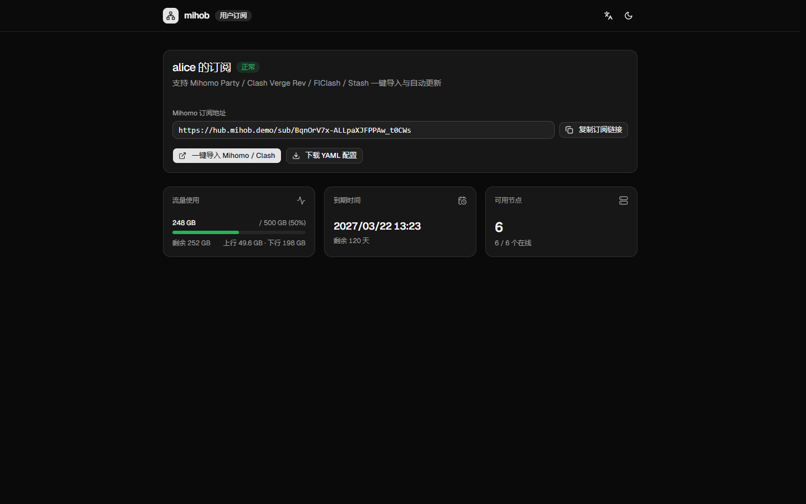

[简体中文](./README.md)

# mihob

**mihob** is a single-binary **Hub + Agent** control plane for multi-node, multi-user **Mihomo** (`listeners`) proxy deployments, featuring an embedded React management console and a self-service user subscription portal.

## Key Features

- **15 Mihomo Server Protocols**: Full support for all Mihomo `listeners` protocols with form editors, YAML deep-merge overrides, and live preview.
- **Reverse WebSocket Sync & Core Upgrades**: Agents connect outbound to Hub with zero exposed management ports; config pushes run `mihomo -t` validation with auto-rollback, plus fleet-wide safe core hot-upgrades.
- **Outbounds & Cloudflare Integration**: Per-node WireGuard / MASQUE (built-in Agent-side WARP & Zero Trust JWT registration), SOCKS5 / HTTP / custom YAML, and node chaining; built-in `cloudflared` supervision with dedicated `-cf` Agent images.
- **Dual Template Engine**: Dynamic client subscription templates (custom sub-path + subscription portal) and reusable node server templates (anti-abuse rules, unlock routing, `type: mihob-node` chaining).
- **Rule-Based Access & Observability**: Authorize users by region, tags, protocol, or regex with auto-kick on expiry/quota; interactive node, user, and User × Node traffic trend charts plus multi-channel alerts.
- **Certificate Center & Themes**: ACME auto-issuance and renewal (Cloudflare / Alibaba Cloud DNS / DNSPod / HTTP-01), multiple themes, light/dark mode, and English/Chinese i18n.

## Screenshots

<details>
<summary>Click to expand previews</summary>

<br />

<table width="100%">
  <thead>
    <tr>
      <th width="50%" align="center">Dashboard (Dark)</th>
      <th width="50%" align="center">Dashboard (Light)</th>
    </tr>
  </thead>
  <tbody>
    <tr>
      <td width="50%" align="center"></td>
      <td width="50%" align="center"></td>
    </tr>
  </tbody>
</table>

<table width="100%">
  <thead>
    <tr>
      <th width="50%" align="center">Nodes</th>
      <th width="50%" align="center">Users</th>
    </tr>
  </thead>
  <tbody>
    <tr>
      <td width="50%" align="center"></td>
      <td width="50%" align="center"></td>
    </tr>
  </tbody>
</table>

<table width="100%">
  <thead>
    <tr>
      <th width="50%" align="center">Templates</th>
      <th width="50%" align="center">Subscription</th>
    </tr>
  </thead>
  <tbody>
    <tr>
      <td width="50%" align="center"></td>
      <td width="50%" align="center"></td>
    </tr>
  </tbody>
</table>

</details>

## Quick Deployment

### Docker Image Tags

| Image & Tag | Description |
| --- | --- |
| `ghcr.io/tom2almighty/mihob-hub:latest` / `:vX.Y.Z` | Hub control plane with embedded Web UI |
| `ghcr.io/tom2almighty/mihob-agent:latest` / `:vX.Y.Z` | Standard lightweight Agent image (`mihob-agent` + `mihomo`) |
| `ghcr.io/tom2almighty/mihob-agent:latest-cf` / `:vX.Y.Z-cf` | Cloudflare Tunnel Agent variant with built-in `cloudflared` — set `CF_TUNNEL_TOKEN` to run Tunnel inside the same container without a separate sidecar |

### Docker Compose (Hub)

```yaml
services:
  mihob-hub:
    image: ghcr.io/tom2almighty/mihob-hub:latest
    container_name: mihob-hub
    restart: unless-stopped
    ports:
      - "8080:8080"
    environment:
      MIHOB_HOST: "0.0.0.0"
      MIHOB_PORT: "8080"
      MIHOB_DATA_DIR: "/data"
      MIHOB_ADMIN_USER: "admin"
      MIHOB_ADMIN_PASS: "${MIHOB_ADMIN_PASS:-}"
      TZ: "Asia/Shanghai"
    volumes:
      - ./hub-data:/data
```

```bash
docker compose -f deploy/docker-compose.hub.yml up -d
```

### Docker Compose (Agent)

```yaml
services:
  mihob-agent:
    image: ghcr.io/tom2almighty/mihob-agent:latest # Use latest-cf for built-in Cloudflare Tunnel
    container_name: mihob-agent
    restart: unless-stopped
    network_mode: host
    environment:
      MIHOB_HUB_URL: "${MIHOB_HUB_URL:?Set MIHOB_HUB_URL}"
      MIHOB_NODE_TOKEN: "${MIHOB_NODE_TOKEN:?Set MIHOB_NODE_TOKEN}"
      MIHOB_DATA_DIR: "/data"
      # Optional when using the latest-cf image:
      # CF_TUNNEL_TOKEN: "<CLOUDFLARE_TUNNEL_TOKEN>"
      TZ: "Asia/Shanghai"
    volumes:
      - ./agent-data:/data
```

```bash
MIHOB_HUB_URL="https://hub.example.com" MIHOB_NODE_TOKEN="<token>" \
  docker compose -f deploy/docker-compose.agent.yml up -d
```

### Binary Deployment

Download prebuilt archives from [GitHub Releases](https://github.com/tom2almighty/mihob/releases):

- **Hub** (`mihob_<version>_<os>_<arch>.tar.gz` / `.zip`):

```bash
tar -xzf mihob_<version>_linux_amd64.tar.gz
chmod +x ./mihob
./mihob hub --host 0.0.0.0 --port 8080 --data ./data
```

If `MIHOB_ADMIN_PASS` is omitted on first start, an initial password is generated and printed to the logs.

- **Agent** (`mihob-agent_<version>_linux_<arch>.tar.gz`):
  - **Recommended**: Copy the one-line installer from **Nodes → Deploy → Linux Binary** in the Hub console to install `mihomo`, `mihob-agent` (optionally `--cf-token` for `cloudflared`), and a `systemd` service (`--update` and `--uninstall` supported).
  - **Manual run**:

```bash
tar -xzf mihob-agent_<version>_linux_amd64.tar.gz
chmod +x ./mihob-agent
./mihob-agent --hub "https://hub.example.com" --token "<NODE_TOKEN>" --data ./agent-data --mihomo-bin /usr/local/bin/mihomo
```

## Configuration & Environment Variables

On first boot, Hub generates `{data_dir}/config.yaml` (override with `--config` or `MIHOB_CONFIG`). Precedence: **CLI flags > Environment variables > `config.yaml` > Defaults**. Dynamic settings (public URL, subscription sub-path, themes, etc.) are hot-reloaded in the Web UI.

### Hub Environment Variables

| Variable | Default | Description |
| --- | --- | --- |
| `MIHOB_CONFIG` | `<data_dir>/config.yaml` | Path to Hub YAML config file |
| `MIHOB_HOST` | `0.0.0.0` | HTTP listen host (e.g. `127.0.0.1` or `0.0.0.0`) |
| `MIHOB_PORT` | `8080` | HTTP listen port |
| `MIHOB_DATA_DIR` | `./data` | Data directory for SQLite and ACME state |
| `MIHOB_ADMIN_USER` | `admin` | Initial admin username |
| `MIHOB_ADMIN_PASS` | Empty | Initial admin password (randomly generated and logged on first boot if empty) |
| `MIHOB_TRAFFIC_RETENTION_DAYS` | `365` | Retention days for hourly traffic history (`0` disables pruning) |
| `MIHOB_TRUST_PROXY` | `false` | Trust `X-Forwarded-For` / `X-Real-IP` from non-private proxies (loopback/private proxies are trusted by default) |
| `MIHOB_CORS_ORIGINS` | Empty | Extra allowed CORS origins (comma-separated; same-origin & `hub_public_url` are allowed by default) |
| `MIHOB_ALLOW_PRIVATE_WEBHOOK` | `false` | Allow notification webhooks targeting private/LAN addresses (blocked by default for SSRF protection) |

### Agent Environment Variables

| Variable | Default | Description |
| --- | --- | --- |
| `MIHOB_HUB_URL` | Required | Hub public URL |
| `MIHOB_NODE_TOKEN` | Required | Node authentication token |
| `MIHOB_DATA_DIR` | `./agent-data` | Agent runtime data directory |
| `MIHOB_MIHOMO_BIN` | `mihomo` | Path to the Mihomo binary |
| `CF_TUNNEL_TOKEN` | Empty | Cloudflare Tunnel token (enables built-in `cloudflared` supervision; also accepts `TUNNEL_TOKEN`) |
| `CF_TUNNEL_PROTOCOL` | Auto | Tunnel transport protocol (`quic` or `http2`) |
| `CF_TUNNEL_EDGE_IP` | Auto | Tunnel edge IP version (`4` or `6`) |
| `CF_TUNNEL_HA_CONNECTIONS` | `4` | High-availability connection count (`1` / `2` / `4`) |
| `CF_TUNNEL_LOGLEVEL` | `info` | `cloudflared` log level (`info` / `warn` / `error` / `debug`) |
| `CF_TUNNEL_BIN` | `cloudflared` | Path to the `cloudflared` binary |

## Local Development & Build

**Prerequisites**: Go 1.27+ · Node.js 24+ · pnpm 12+

```bash
# Local development
cd web && pnpm install --frozen-lockfile
go run ./cmd/mihob hub --host 0.0.0.0 --port 8080 --data ./data   # Terminal 1: Hub (:8080)
cd web && pnpm dev                                                 # Terminal 2: Vite (:5173)

# Production build (embeds frontend into the Go binary)
cd web && pnpm install --frozen-lockfile && pnpm build
cd .. && CGO_ENABLED=0 go build -trimpath -ldflags="-s -w" -o bin/mihob ./cmd/mihob
```

## License

Licensed under [AGPL-3.0](LICENSE).
