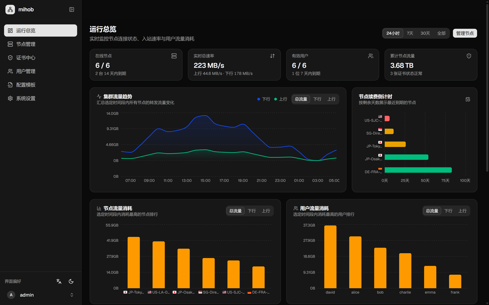
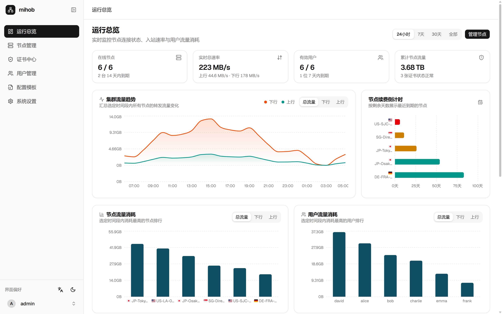
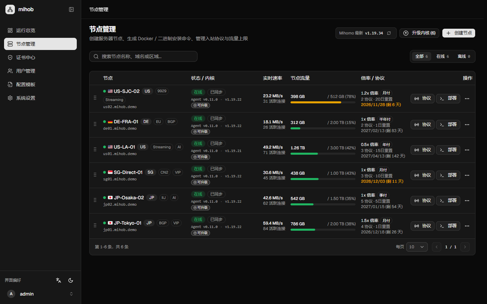
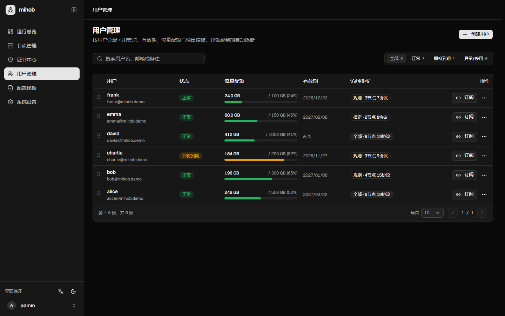
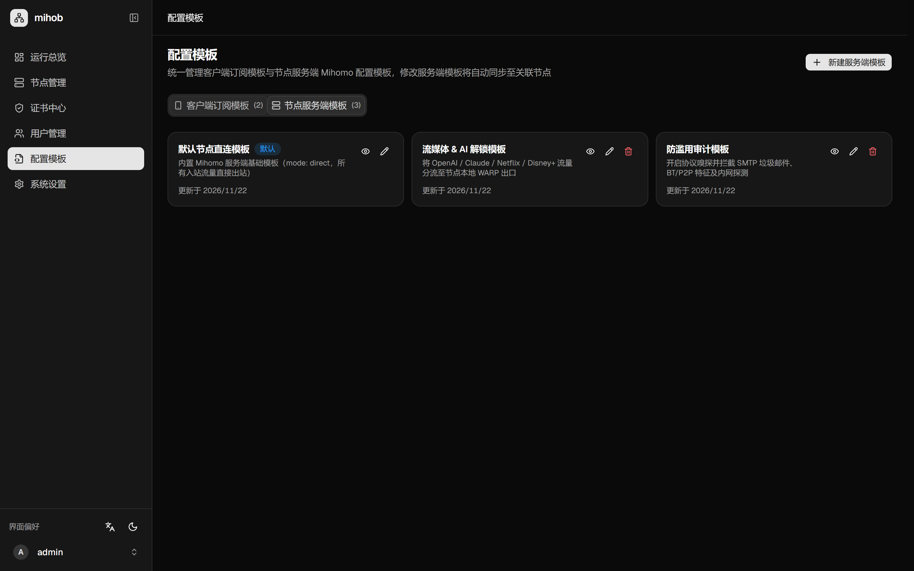
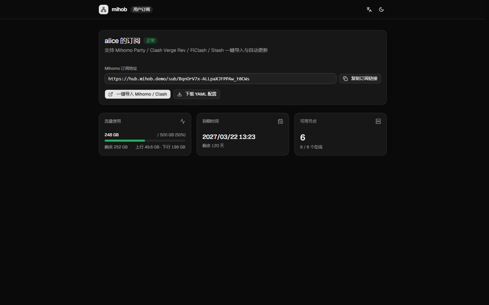

[English](./README.en.md)

# mihob

## 项目简介

**mihob** 是一个基于 Mihomo 服务端入站（`listeners`）的多节点、多用户代理部署与订阅管理控制平面，采用单二进制 **Hub + Agent** 反向 WebSocket 隧道架构，内置现代化 React 管理控制台与用户自助订阅页。

### 核心特性

- **15 种 Mihomo 服务端入站协议**：完整支持 Mihomo 入站及 YAML 深度合并与实时预览。
- **Hub + Agent 零端口暴露同步**：Agent 主动反向连接 Hub，配置下发前自动执行 `mihomo -t` 校验并在失败时回滚；支持一键检测与安全热升级全集群 Mihomo 内核（SHA-256 校验 + 探活回滚）。
- **双模板引擎（客户端订阅 + 节点服务端配置）**：
  - 客户端订阅模板动态渲染授权节点与策略组，支持自定义订阅路径与浏览器自助订阅页。
  - 节点服务端模板支持防滥用审计（BT/SMTP 阻断）、流媒体 / AI 解锁分流、`type: mihob-node` 动态引用集群节点链式代理（自动注入内部中转凭证与防自环），以及单节点级覆盖（`log-level` / `ipv6` / 附加 YAML）+ 下发前实时预览。
- **精细化用户授权与配额管控**：支持按地区、标签、协议与正则动态授权，实时统计流量并在到期或超额时自动剔除并踢断活跃连接。
- **集中证书中心**：支持 ACME（Cloudflare / 阿里云 DNS / DNSPod / HTTP-01）自动签发与续期、自签与手动 PEM 导入，并自动同步至关联节点。
- **现代控制台体验**：浅色 / 深色模式、内置与自定义 tweakcn 主题、中英文双语切换。

## 界面预览

<details>
<summary>点击展开预览</summary>

<br />

<table width="100%">
  <thead>
    <tr>
      <th width="50%" align="center">运行总览（深色模式）</th>
      <th width="50%" align="center">运行总览（浅色模式）</th>
    </tr>
  </thead>
  <tbody>
    <tr>
      <td width="50%" align="center"></td>
      <td width="50%" align="center"></td>
    </tr>
  </tbody>
</table>

<table width="100%">
  <thead>
    <tr>
      <th width="50%" align="center">节点管理</th>
      <th width="50%" align="center">用户管理</th>
    </tr>
  </thead>
  <tbody>
    <tr>
      <td width="50%" align="center"></td>
      <td width="50%" align="center"></td>
    </tr>
  </tbody>
</table>

<table width="100%">
  <thead>
    <tr>
      <th width="50%" align="center">配置模板</th>
      <th width="50%" align="center">用户订阅</th>
    </tr>
  </thead>
  <tbody>
    <tr>
      <td width="50%" align="center"></td>
      <td width="50%" align="center"></td>
    </tr>
  </tbody>
</table>

</details>

## 开发环境配置

### 依赖要求

- Go 1.27+
- Node.js 24+
- pnpm 12+

### 环境变量

Hub 常用环境变量：

| 变量名 | 说明 | 默认值 |
| --- | --- | --- |
| `MIHOB_HOST` | HTTP 监听主机地址（如 `127.0.0.1` 或 `0.0.0.0`） | `0.0.0.0` |
| `MIHOB_PORT` | HTTP 监听端口 | `8080` |
| `MIHOB_DATA_DIR` | SQLite 数据库与 ACME 证书存储目录 | `./data` |
| `MIHOB_ADMIN_USER` | 初始管理员用户名 | `admin` |
| `MIHOB_ADMIN_PASS` | 初始管理员密码（留空时首次启动随机生成并打印至日志） | 空 |
| `MIHOB_TRAFFIC_RETENTION_DAYS` | 小时级流量历史保留天数（`0` 表示永久保留） | `365` |
| `MIHOB_TRUST_PROXY` | 强制信任反代 `X-Forwarded-For` / `X-Real-IP`（环回与内网反代默认已信任） | `false` |
| `MIHOB_CORS_ORIGINS` | 额外允许的跨域 `Origin` 列表（逗号分隔；默认允许同源及 `hub_public_url`） | 空 |
| `MIHOB_ALLOW_PRIVATE_WEBHOOK` | 允许通知渠道推送至内网/局域网 Webhook 地址（默认拦截私有网段以防 SSRF） | `false` |

Agent 常用环境变量：

| 变量名 | 说明 | 默认值 |
| --- | --- | --- |
| `MIHOB_HUB_URL` | Hub 访问地址（必填） | 无 |
| `MIHOB_NODE_TOKEN` | 节点鉴权 Token（必填） | 无 |
| `MIHOB_DATA_DIR` | Agent 运行数据目录 | `./agent-data` |
| `MIHOB_MIHOMO_BIN` | Mihomo 可执行文件路径 | `mihomo` |

### 本地调试

```bash
# 安装前端依赖
cd web && pnpm install --frozen-lockfile

# 终端 1：启动 Hub 后端（监听 0.0.0.0:8080）
go run ./cmd/mihob hub --host 0.0.0.0 --port 8080 --data ./data

# 终端 2：启动前端开发服务器（监听 :5173，自动代理后端接口）
cd web && pnpm dev
```

## 构建与部署

### 生产构建

```bash
# 构建前端静态产物（将内嵌至 Go 二进制）
cd web && pnpm install --frozen-lockfile && pnpm build

# 编译单二进制可执行文件
cd ..
CGO_ENABLED=0 go build -trimpath -ldflags="-s -w" -o bin/mihob ./cmd/mihob
```

### 二进制方式运行

可从 [GitHub Releases](https://github.com/tom2almighty/mihob/releases) 下载对应平台预编译压缩包（或按上方「生产构建」自行编译）：

- **Hub**（`mihob_<version>_<os>_<arch>.tar.gz` / `.zip`）：

```bash
tar -xzf mihob_<version>_linux_amd64.tar.gz
chmod +x ./mihob

# 直接启动（也可通过环境变量 MIHOB_HOST / MIHOB_PORT / MIHOB_DATA_DIR / MIHOB_ADMIN_PASS 配置）
./mihob hub --host 0.0.0.0 --port 8080 --data ./data
```

首次启动未指定 `MIHOB_ADMIN_PASS` 时，控制台日志会打印自动生成的初始管理员密码；生产环境建议配合 `systemd` 守护运行并通过反代提供 HTTPS。

- **Agent**（`mihob-agent_<version>_linux_<arch>.tar.gz`）：
  - **推荐**：在 Hub 控制台「节点管理 → 部署 → 二进制脚本」中复制一键命令，自动安装 `mihomo`、`mihob-agent` 并注册 `systemd` 服务（同样支持 `--update` 更新与 `--uninstall` 卸载）。
  - **手动运行**（节点需先安装 `mihomo` 可执行文件）：

```bash
tar -xzf mihob-agent_<version>_linux_amd64.tar.gz
chmod +x ./mihob-agent

./mihob-agent \
  --hub "https://hub.example.com" \
  --token "<NODE_TOKEN>" \
  --data ./agent-data \
  --mihomo-bin /usr/local/bin/mihomo
```

### Docker Compose 启动（Hub）

```yaml
services:
  mihob-hub:
    image: ghcr.io/tom2almighty/mihob-hub:latest
    container_name: mihob-hub
    restart: unless-stopped
    ports:
      - "8080:8080"
    environment:
      MIHOB_HOST: "0.0.0.0"
      MIHOB_PORT: "8080"
      MIHOB_DATA_DIR: "/data"
      MIHOB_ADMIN_USER: "admin"
      MIHOB_ADMIN_PASS: "${MIHOB_ADMIN_PASS:-}"
      TZ: "Asia/Shanghai"
    volumes:
      - ./hub-data:/data
```

启动命令：

```bash
docker compose -f deploy/docker-compose.hub.yml up -d
```

### Docker Compose 启动（Agent）

```yaml
services:
  mihob-agent:
    image: ghcr.io/tom2almighty/mihob-agent:latest
    container_name: mihob-agent
    restart: unless-stopped
    network_mode: host
    environment:
      MIHOB_HUB_URL: "${MIHOB_HUB_URL:?Set MIHOB_HUB_URL}"
      MIHOB_NODE_TOKEN: "${MIHOB_NODE_TOKEN:?Set MIHOB_NODE_TOKEN}"
      MIHOB_DATA_DIR: "/data"
      TZ: "Asia/Shanghai"
    volumes:
      - ./agent-data:/data
```

启动命令：

```bash
MIHOB_HUB_URL="https://hub.example.com" MIHOB_NODE_TOKEN="<token>" \
  docker compose -f deploy/docker-compose.agent.yml up -d
```

## 开源许可证

本项目采用 [AGPL-3.0](LICENSE) 开源许可证。
